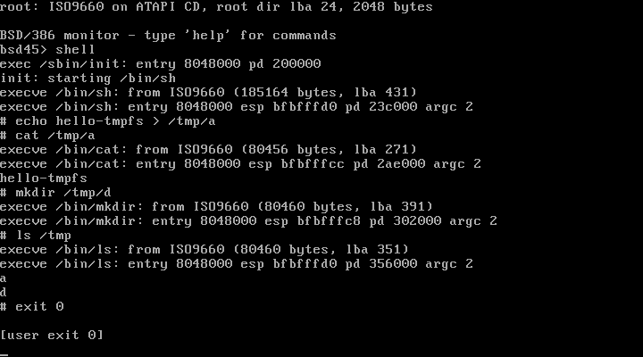

# BSD45_rootfs_shell_finished

用 **MSYS2 mingw32 的 i386 GCC**（`i686-w64-mingw32-gcc 16.2.0`）编译
**4.4BSD-Lite2 `sys/i386`** 的机器相关核心，生成 **UNIX System V ELF32
(Intel 80386)** 内核，并做成 **El Torito 无仿真引导** 的 ISO。
ISO 里的内核是 **ELF**，不是 PE/EXE。



## 产物

| 文件 | 说明 |
|---|---|
| `BSD45-ELF-x86.iso` | 4.5 MB，VMware / QEMU 可直接从光盘启动 |
| `BSD45.ELF` | 内核：`ELF32 EXEC, Intel 80386`，KERNBASE `0xFE000000`，无 SSE/MMX |
| `screenshot.png` | QEMU 中 VGA 文本控制台实拍 |
| `bsd45/` | 完整工程：构建脚本、引导器、内核 glue、文档、VMware vmx |
| `4.4BSD-Lite2.tar.gz` | 原始 4.4BSD-Lite2 源码（构建时自动解包） |

启动后串口/VGA 输出：

```
4.4BSD-Lite2 (i386) ELF kernel
Kernel: ELF32 i386, KERNBASE fe000000, first free page 50000
Memory: maxmem 4000000, physmem 3fa0000, avail 100000-3ffe000
pmap: kernel_pmap 0xfe047010 pdir 0xfe049000 IdlePTD 49000
VM: virtual_avail fe0bd000 virtual_end ff7ff000

BSD/386 monitor - type 'help' for commands
bsd45> mem
Maxmem    16384 pages  (67108864K)
...
bsd45> map
mapped page at 0xfe0bd000
pte new page: 100063
readback 4f534442 444e4521
ok
```

`map` 走的是 4.4BSD 真正的 `pmap_bootstrap_alloc() → pmap_map() →
pmap_enter()` 路径。

## 构建

依赖（本机路径）：

```
C:\msys64\mingw32\bin\gcc.exe        i686-w64-mingw32-gcc 16.2.0
C:\msys64\mingw32\bin\ld.exe          GNU ld 2.47 (i386pe)
C:\msys64\mingw32\bin\objcopy.exe     支持 -O elf32-i386
C:\Program Files (x86)\VMware\VMware Workstation\mkisofs.exe
C:\Program Files\qemu\qemu-system-i386.exe
```

```powershell
cd bsd45
powershell -NoProfile -ExecutionPolicy Bypass -File .\build_all.ps1
powershell -NoProfile -ExecutionPolicy Bypass -File .\verify.ps1
```

`build_kernel.ps1` 会自动：

1. 若 `src/` 不存在，把上层目录的 `4.4BSD-Lite2.tar.gz` 解包；
2. 把 `overlay/` 里针对现代 GCC 修补过的 4 个文件覆盖上去；
3. 准备 `machine/ sys/ vm/ i386/ libkern/` 头文件视图；
4. `gcc -m32 -c` → `ld -m i386pe --image-base 0xFE000000` →
   `objcopy -O elf32-i386`，得到 `ET_EXEC` ELF32；
5. 用 `--defsym _end/_edata/_etext` 补齐 `locore.s` 需要的边界符号。

工具链关键点：mingw 的 `ld` 只有 `i386pe` 仿真，不能直接
`--oformat elf32-i386`；必须先链接成 PE 再 `objcopy` 成 ELF。
`gcc -B C:/msys64/mingw32/bin/` 必须有，否则驱动找不到 `as.exe`。

## 引导链

```
BIOS → El Torito (no-emulation) 加载 boot.img 到 0x7C00
  stage1 (512 B, 实模式)
    - 从镜像内 BDMF manifest 读内核 LBA (2048) 和字节数
    - INT 13h AH=42h，按 CD 的 2048 字节扇区，每次 16 扇区读入 0x10000
    - 复制 stage2 到 0x90000，开 A20，装 GDT，进保护模式
  stage2 (32 位, 链接在 0x90000)
    - 快照 ELF 头到 0x8F000
    - 每个 PT_LOAD: dst = p_vaddr - 0xFE000000，rep movsb，清 bss
    - 压 howto/bootdev/unit/cyloffset，跳 e_entry - 0xFE000000
内核 locore.s:start
    - 自建 GDT/页表，物理 0..kernel_end 映射到 0xFE000000+
    - call init386: GDT/IDT/LDT/TSS、RTC 测内存、pmap_bootstrap
    - main() → 板载 monitor
```

## 4.4BSD 原文件

以下文件来自 `sys/i386`，未重写：

- `i386/i386/locore.s`（Jolitz）
- `i386/i386/pmap.c`（Mach pmap，Reno i386 版）
- `i386/i386/machdep.c`（`init386`、`setidt` 等）
- `i386/i386/cons.c`（控制台抽象层）
- `i386/isa/icu.s`（8259、`spl*`、`doreti`）

`kernel/` 下是本项目补的 glue：`main`、kprintf、`proc0`、VGA+COM1 驱动、
trap、monitor、少量 stub。

## 现代 GCC 修补（overlay/）

| 文件 | 修补 | 原因 |
|---|---|---|
| `locore.s` | `ENTRY/ALTENTRY/IDTVEC` 改 `_##name`；`movb %eax`→`%al`；`movl %ax,%ds`→`movw` | 现代 cpp 把 `/**/` 变成空格；gas 拒绝寄存器宽度不匹配 |
| `icu.s`（构建时 include） | 增加 `#include "icu.h"`、`"isa.h"` | 原构建由 config 提供 `IO_ICU1` 等常量 |
| `pmap.c` | `static boolean_t pmap_testbit();` | C99 起 static 后置声明是错误 |
| `machdep.c` | `sendsig(..., u_long code)`、`const char *panicstr` | 与头文件原型一致 |
| `machdep.c` | `lgdt(&r_gdt); lidt(&r_idt);` | 本树 `lgdt` 只接受 `region_descriptor *` |
| `segments.h` | `region_descriptor` 6 字节 packed；`segment_descriptor` 两个 32 位字 | GCC 16 的 16+24 位域跨 32 位单元，GDT 步长错 |

详细清单与构建参数见 [`bsd45/README.md`](bsd45/README.md)。

## 启动

```powershell
# QEMU
& "C:\Program Files\qemu\qemu-system-i386.exe" `
  -cdrom BSD45-ELF-x86.iso -boot d -m 64 -serial stdio

# VMware: File -> Open -> bsd45\vms\BSD45-ELF-x86.vmx
```

VMware 提示：启动后先**点一下 VM 窗口**再敲键盘（VMware 需要捕获输入）。
没有配置串口的 VM，启动行会显示 `Console: VGA 80x25, COM1 absent`，这是正常的；
早期 ISO 在这种情况下键盘会失灵（VMware 未映射端口读回 `0xff`，被误判成串口有数据），
现已修复并加了 `tools/test_kbd.ps1` 回归。

## 边界说明

这是一颗 **可启动的 4.4BSD-Lite2 i386 内核 + 最小用户态**：保护模式、分页、
GDT/IDT/TSS、物理内存探测、Mach pmap 引导、可交互 monitor 均已跑通。

S1–S9 之后，ISO 的内核会自己用 ATAPI(PIO) 读光盘、挂上 **ISO9660 root**，
`/sbin/init` 与**真正的 4.4BSD `/bin/sh`** 都是光盘上的文件；内核有进程表、
`fork/vfork/wait4/exit`、**控制台 tty**、**目录/通配符**、**pipe**，以及
一块可写的 **tmpfs**（`/tmp`）。S9 把 ramfs/ISO/tmpfs 的三套特判收进一个
**vnode/VFS 层**（`vnodeops` + 挂载点），syscall 与 `execve` 都只认 vnode：

```
bsd45> shell
# ls /bin                     <- ISO9660，经 vnode readdir
# cat /readme.txt             <- ISO9660 文件，经 vnode read
# echo vfs-ok > /tmp/a        <- tmpfs，经 vnode create/write
# cat /tmp/a
vfs-ok
# echo hi-vfs | cat           <- pipe
hi-vfs
```

它**还不是**完整系统：没有页/vnode 回收、没有作业控制与信号投递、
没有 `rm`/`cp` 等工具，VFS 也还只有两个后端、没有真正的 mount 表与权限。
“ELF 内核 + El Torito 引导”“光盘 root 跑 BSD sh”“fork/exec 外部命令”
“控制台 tty”“目录/管道”“可写 tmpfs + 重定向”“vnode/VFS 统一层”
都已达成。


## 目录布局

```
bsd45/
  kernel/                   内核（4.4BSD-Lite2 sys 树与自有内核代码合并）
    include/sys/            原 usr/src/sys/sys 的头文件
    include/machine/        原 sys/i386/include
    arch/i386/i386/         机器相关源码（locore.s、machdep.c、pmap.c、cons.c）
    arch/i386/{isa,conf,...}  i386 下的驱动/配置/启动代码
    fs/                     ufs/miscfs/isofs/nfs + 自有的 vfs.c、isofs.c
    vm/                     Mach VM（pmap 源）
    libkern/                内核库例程（bcmp/strcmp/strlen/quad 等）
    libexec/                内核辅助程序（预留）
    driver/                 dev + 自有的 atapi.c、pccon.c
    net/                    net/netinet/netiso/netccitt/netns
    other/                  kern、conf、libkern、tests + 自有的 glue.c/mon.c/
                            usermode.c/stubs.c/strings.c
  libc/                     用户态 C 库与工具
    include/                stdarg.h、ctype.h、histedit.h（用户态头文件）
    src/                    crt0.s、libc_sys.c、dtoa.c … 与 hello/init/sh/ls/
                            cat/mkdir/echo/t_libc 等程序
  rootfs_overlay/           ISO 根文件系统的覆盖层
    bin/ sbin/ usr/ tmp/ etc/ home/ include/ sys/
    etc/profile             /etc/profile
    README.TXT              /readme.txt
  boot/                      stage1/stage2（El Torito 引导）
  overlay/                   4.4BSD 源码的本地补丁（按 kernel 树镜像）
  tools/                     ensure-src、clean、测试脚本
  libc/docs/                 USERLAND-PLAN.md
  vms/                       VMware 虚拟机定义

`kernel/` 的每个目录（含子目录）都有一个 `config.mk`：
它是 kbuild 风格构建的目录级配置位（obj-y/obj-m/dir-y），
由 `tools/gen-config-mk.ps1` 生成，随源码一起进仓库。
  src/BSD45/                 仍由 tarball 解出的 4.4BSD 用户态源码
                             （usr/src/lib、usr/src/bin/sh 等，构建时使用）
```

`kernel/include/sys`、`kernel/arch`、`kernel/vm`、`kernel/net`、`kernel/driver/dev`
等 4.4BSD 子树由 `tools/ensure-src.ps1` 从 tarball 解出后自动归位，不进入 git；
仓库只跟踪自有的 kernel/libc/rootfs_overlay 代码。

## 许可
## 许可

`4.4BSD-Lite2.tar.gz` 与 `bsd45/overlay/` 中的 4.4BSD 代码遵循其原始
BSD 版权许可以及 UC Berkeley 的 advertising 条款；本项目新增的脚本、
引导器与 glue 代码可视为同一 BSD 风格许可。

## 从仓库恢复 / 重建

```bash
# 防火墙可能会重置 HTTPS 大文件传输，用 SSH 更稳（本机已配置 key）
git clone git@github.com:moccuishle/BSD45_rootfs_shell_finished.git
cd BSD45_rootfs_shell_finished/bsd45
powershell -NoProfile -ExecutionPolicy Bypass -File .\build_all.ps1
powershell -NoProfile -ExecutionPolicy Bypass -File .\verify.ps1
```

仓库自带 `4.4BSD-Lite2.tar.gz`、`overlay/` 与全部脚本，构建时会自动解包并
应用修补，不需要再找源码。产物 `BSD45-ELF-x86.iso` / `BSD45.ELF` 也已在
仓库根目录，即使不重新编译也能直接启动。

### 在另一台 Windows 电脑上

脚本会自动查找工具链，不再依赖固定路径（`bsd45/tools-find.ps1`）：

| 工具 | 自动查找顺序 / 覆盖方式 |
|---|---|
| MSYS2 mingw32 | `%MSYS2_ROOT%`、`C:\msys64`、`C:\msys2`、`%ProgramFiles%\msys64`、PATH 里的 `i686-w64-mingw32-gcc` |
| GCC include | `gcc -print-file-name=include`（自动跟随实际 GCC 版本） |
| mkisofs | `%MKISOFS%`、VMware Workstation/Player、`C:\msys64\usr\bin\mkisofs.exe` 或 `xorriso.exe`、PATH |
| QEMU | `%QEMU%`、`%ProgramFiles%\qemu\...`、PATH；找不到时 `verify.ps1` 跳过运行时检查并返回成功 |

安装（任选）：

```powershell
# MSYS2: https://www.msys2.org
pacman -S mingw-w64-i686-gcc mingw-w64-i686-binutils

# ISO 工具：任选其一
pacman -S cdrtools      # 或 xorriso
# 或者安装 VMware Workstation，用自带的 mkisofs.exe

# 可选，仅 verify.ps1 需要
# 安装 QEMU for Windows
```

GCC 版本不必是 16.2.0：include 路径由 `gcc -print-file-name=include` 得到。
不过内核是 1994 年的 K&R 代码，更新的 GCC 可能引入新的诊断；仓库默认参数在
**16.2.0** 上验证通过。

**不装工具链也能用**：仓库里已有 `BSD45-ELF-x86.iso` 与 `BSD45.ELF`，
另一台电脑只要装 VMware 或 QEMU 就能直接启动，不需要编译。

**Linux / macOS**：这些 `.ps1` 脚本不适用。需要 `i686-w64-mingw32-*`
交叉工具链（或 i686-elf-gcc）并改写构建命令；COFF→PE→objcopy 的思路不变，
`overlay/` 里的源码修补与引导器可以直接复用。

## 用户态进度（S9）

- 已完成：ring3、`execve`、`int 0x80`、4.4BSD libc 子集、真正的 `/bin/sh`、
  **ATAPI + ISO9660 root**、**fork/vfork/wait4**、**tty/termios**、
  **目录 + 通配符 + pipe**、**tmpfs + 重定向**、**vnode/VFS 统一层**；
- 光盘工具：`/bin/sh`、`/bin/echo`、`/bin/ls`、`/bin/cat`、`/bin/mkdir`、
  `/sbin/init`、`/test`；
- 可写目录：`/tmp`（tmpfs，一页一个文件，支持 create/truncate/append/
  unlink/mkdir/rmdir）；
- 仍然没有：页/vnode 回收、作业控制、`rm`/`cp` 等工具、真正的 mount 表。
  路线见 [`bsd45/libc/docs/USERLAND-PLAN.md`](bsd45/libc/docs/USERLAND-PLAN.md)。
